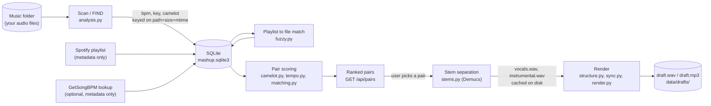

# Architecture

Mashup Maker is a local, single-user tool. A FastAPI backend (`backend/app/`)
analyses audio files you own, ranks pairs of tracks, and renders short drafts.
The frontend (`frontend/`) talks to it over `/api/*` (Vite proxies `/api` to
port 8000 in development). This document describes how the backend fits
together. For setup and usage see the README.

## Data flow

1. **Scan.** `analysis.scan_folder` walks the folder, reads title and artist
   from tags (or the file name), and runs `analyze_file` (librosa) to get BPM,
   key and a key-confidence value. Results go into the `tracks` table. A file is
   re-analysed only when its path, size or mtime changed, or when the stored
   analysis `version` is out of date. Failures are stored too and retried after
   `ANALYSIS_FAILURE_TTL_HOURS`.
2. **Playlist.** `spotify.py` reads playlist metadata (title, artists, duration)
   for a logged-in user. `fuzzy.match_playlist` pairs playlist rows with
   analysed local files one-to-one and stores the result in `playlist_tracks`.
   The match is redone after every scan or find.
3. **Lookup (optional).** For playlist rows with no local file, `songlookup.py`
   fetches BPM and key by title and artist from GetSongBPM and caches them in
   the `lookups` table. Local analysis takes priority over a looked-up value.
4. **Match and rank.** `matching.score_pair` combines a key score
   (`camelot.py`, weight 0.55) and a tempo score (`tempo.py`, weight 0.45).
   `matching.rank_pairs` ranks every pair over the playlist or the whole
   library. It is computed on request and not stored.
5. **Stems.** `stems.separate` runs Demucs on a track and writes
   `vocals.wav` and `instrumental.wav` (everything except vocals, summed). The
   output folder is named from a hash of path, mtime, size and model, so a
   separation is never repeated for an unchanged file.
6. **Render.** `render.render_draft` uses both tracks' stems, picks windows
   using beat, downbeat and phrase structure (`structure.py`), measures
   rhythmic sync (`sync.py`), time-stretches and pitch-shifts the vocals, mixes,
   and exports WAV and MP3 into `drafts/<draft_id>/`.

All persistent state lives under `MASHUP_DATA_DIR` (default `backend/data`):
the SQLite database, `stems/`, `drafts/`, and small settings and token files.

## Job and queue model

Anything slow runs as a job (`jobs.py`) so HTTP requests return quickly with a
`job_id` and the UI polls `GET /api/jobs/{id}`.

- **Persistence.** A job is a row in the `jobs` table: `kind`, `status`
  (`queued`, `running`, `done`, `failed`, `cancelled`), `progress` (0 to 1),
  `message`, `params`, `result`, `error` and a `cancel` flag. Job state is
  written to SQLite on every change, so the API only ever reads the database.
- **Queues.** There are three `ThreadPoolExecutor`s with one worker each:
  `heavy` (scan and find), `render` (Demucs and draft rendering) and `net`
  (key/BPM lookups). Jobs on the same queue run one at a time in submission
  order. A draft does not wait behind a long library scan because it has its
  own queue.
- **Job kinds** used by `main.py`: `scan`, `find`, `lookup`, `draft`.
- **De-duplication.** Starting a scan (same folder), find, or lookup while one
  is already queued or running returns the existing job's id.
- **Cancellation.** `jobs.cancel` marks a queued job `cancelled` immediately.
  For a running job it sets the `cancel` flag. Job functions receive a
  `JobContext`; its `progress()` call doubles as a cancellation point (it checks
  the flag at most every 0.5 s) and raises `Cancelled`, which the runner turns
  into a `cancelled` status. The song lookup also uses cancellable sleeps.
- **Failure.** An unhandled exception marks the job `failed` and stores the
  message with credential-looking query parameters masked (`jobs.redact`).
- **Restart.** At startup `db.init(recover_jobs=True)` marks any job left
  `queued` or `running` by a previous server process as failed
  (`server restarted`), since the in-memory queues are gone.
- **Watcher.** `watcher.FolderWatcher` runs in a daemon thread started in the
  app's lifespan hook. When the `watch` setting is on it wakes every 30 s,
  lists audio files in the FIND folder, and starts a `find` job for files whose
  mtime it has not already checked. It skips a tick while a find job is queued
  or running, resets its memory when the folder or playlist changes, and backs
  off exponentially (1 minute doubling to 30 minutes) after a failed find job.

## Module map (`backend/app/`)

| Module | Role |
|---|---|
| `main.py` | FastAPI app, `/api/*` routes, host-header middleware, lifespan (DB init, watcher start/stop) |
| `config.py` | Environment-based settings and data directory paths |
| `settings.py` | Small persisted user settings (music folder, find folder, watch toggle) |
| `db.py` | SQLite schema and access: tracks, playlist, lookups, jobs |
| `jobs.py` | Job submission, progress/cancel context, per-queue executors |
| `watcher.py` | Polls the FIND folder and starts find jobs |
| `analysis.py` | Folder scan and FIND; BPM and key detection (librosa); tag and filename metadata |
| `camelot.py` | Pitch class/mode to Camelot code, key compatibility score, minimal pitch shift |
| `tempo.py` | Tempo closeness score, including half and double time |
| `matching.py` | Pair scoring and ranking across tracks |
| `fuzzy.py` | Title/artist normalisation and one-to-one playlist-to-file matching |
| `spotify.py` | Spotify login (PKCE) and playlist metadata fetch |
| `songlookup.py` | GetSongBPM key/BPM lookup with caching and rate limiting |
| `stems.py` | Demucs vocal/instrumental separation with on-disk cache |
| `structure.py` | Beat grid, downbeats, 8-bar phrases and section labels |
| `sync.py` | Rhythmic sync measured from onset envelopes |
| `render.py` | Draft rendering: windows, stretch/shift, alignment, mix, export |
| `fsutil.py` | Atomic file writes |

## Decisions

### SQLite for all state

- **Context.** One user on one machine, with thousands of tracks, a playlist,
  cached lookups, and job status that worker threads write and the API reads.
- **Decision.** One SQLite file (`mashup.sqlite3`), opened in WAL mode with a
  shared connection (`check_same_thread=False`) and a lock that serializes
  access from request and worker threads.
- **Consequences.** No server to install, and the analysis cache and job state
  survive restarts. Writes are serialized, which is fine at this scale. Schema
  upgrades are small `ALTER TABLE` checks in `db.init`.

### Demucs for stem separation

- **Context.** A draft needs A's vocals and B's instrumental.
- **Decision.** Use Demucs (`htdemucs` by default, set with `DEMUCS_MODEL`) run
  locally. The device is `auto` (cuda, then mps, then cpu), and an automatically
  chosen GPU falls back to cpu if it fails. Stems are cached per file.
- **Consequences.** Separation is the slowest step, so it lives on its own
  `render` queue, and repeat drafts of the same track are fast. The first run
  downloads the model weights, and quality and speed trade off through
  `DEMUCS_MODEL`, `DEMUCS_SHIFTS` and `DEMUCS_OVERLAP`.

### Local-only API

- **Context.** The app reads files from the user's disk and holds Spotify
  tokens, and has no accounts.
- **Decision.** No authentication and no CORS configuration. Instead
  `TrustedHostMiddleware` rejects any request whose `Host` header is not
  `localhost`, `127.0.0.1` or `[::1]` (extend with `MASHUP_ALLOWED_HOSTS`),
  which blocks DNS-rebinding. Audio is read from the folder you point it at;
  Spotify is used for metadata only.
- **Consequences.** It is not meant to be exposed on a network. Adding hosts to
  `MASHUP_ALLOWED_HOSTS` without adding authentication would let anyone who can
  reach the port start scans of local folders.

## API reference

Routes defined in `backend/app/main.py`. Request and response models are
generated by FastAPI, so the interactive reference at `/docs` (Swagger UI) and
`/openapi.json` on the running backend (for example
<http://127.0.0.1:8000/docs>) is the authoritative source for fields.

| Method | Path | Purpose |
|---|---|---|
| GET | `/api/config` | Saved folders and watch toggle, Spotify and lookup status, whether `rubberband` and `ffmpeg` are available, Demucs model name |
| POST | `/api/library/scan` | Start a `scan` job for a folder (`{folder}`); returns `{job_id}`, reusing a running scan of the same folder |
| GET | `/api/library` | Analysed tracks whose files still exist |
| POST | `/api/find` | Start a `find` job that looks for unowned playlist tracks in a folder (`{folder, watch?}`); needs a loaded playlist |
| POST | `/api/find/watch` | Turn the FIND folder watcher on or off (`{watch}`) |
| GET | `/api/spotify/login` | Redirect to Spotify's login page |
| GET | `/callback` | Spotify redirect target (not under `/api`); finishes login and redirects to the frontend |
| POST | `/api/spotify/logout` | Forget the stored Spotify tokens |
| POST | `/api/playlist` | Fetch a playlist by URL (`{url}`), save it and match it to local files |
| GET | `/api/playlist` | The current playlist with local matches and looked-up key/BPM, or `null` |
| GET | `/api/pairs` | Ranked pairs. Query: `scope` (`playlist` or `library`), `limit`, `min_score`, `focus`, `owned` |
| POST | `/api/lookup` | Start a key/BPM lookup job for playlist tracks (needs `GETSONGBPM_API_KEY`) |
| POST | `/api/drafts` | Start a `draft` render job (`vocals_id`, `instrumental_id`, `duration`, `semitones`, `vocal_gain_db`, `quantize`) |
| GET | `/api/drafts` | Results of finished draft jobs |
| DELETE | `/api/drafts/{draft_id}` | Delete a draft's files and its job rows |
| GET | `/api/drafts/{draft_id}/{filename}` | Download `draft.wav` or `draft.mp3` |
| GET | `/api/jobs` | Recent jobs, optionally filtered by `kind` |
| GET | `/api/jobs/{job_id}` | One job's status, progress, result or error |
| POST | `/api/jobs/{job_id}/cancel` | Request cancellation; returns `{cancelled: bool}` |
